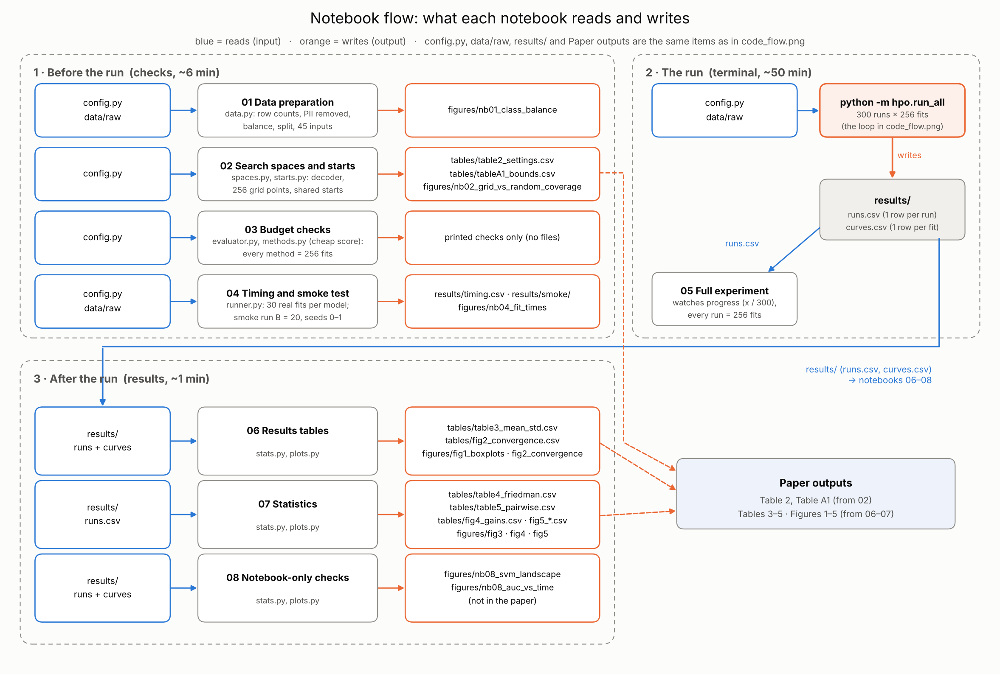
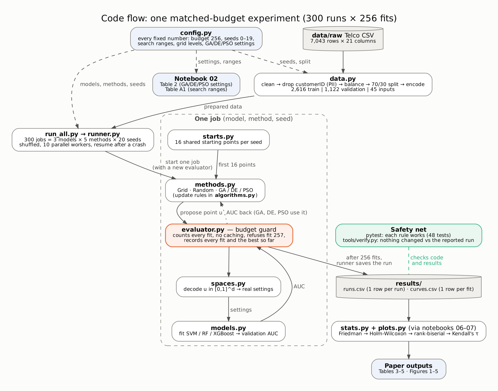

# Metaheuristics vs Grid and Random Search under a Matched Evaluation Budget

This repository compares five ways of tuning machine-learning models (**GA, DE, PSO, Grid Search and Random Search**)
on three models (**SVM, Random Forest and XGBoost**). Every method gets the **same budget of 256 model fits**, and every
comparison is repeated with **20 seeds**.

**Research questions**
- **Q1.** With the same budget, does GA, DE or PSO beat both Grid and Random Search? If so, which one, and at what run-time cost?
- **Q2.** Does any advantage grow as the number of hyperparameters grows (SVM 2 → Random Forest 4 → XGBoost 5)?
- **Q3.** Do the five methods rank the same way on all three models?

Methods are compared on validation AUC with standard tests (Friedman, Holm-corrected Wilcoxon, rank-biserial, Kendall's tau).
The tables and figures are those of the accompanying paper (link to follow when it is published).

**Data:** [Telco Customer Churn](https://www.kaggle.com/datasets/blastchar/telco-customer-churn) (BlastChar, 2018, Kaggle),
7,043 customers, in `data/raw/`. The code removes the customer ID and 11 incomplete rows, balances churn and no-churn
(3,738 rows), and splits them 70/30 into training and validation rows.

**Three ways to use this repository**

| You want to… | Do this | Setup needed? |
|---|---|---|
| **See the results only** | Open `results/figures/` and `results/tables/`, or open notebooks 02 and 06–08 (their saved outputs show every table and figure). Section 1 explains how to read them. | No |
| **Redraw the tables and figures** from the saved results | Set up (section 3), then run notebooks 02 and 06–08 (~1 min; no models are trained). | Yes |
| **Reproduce the whole experiment** | Set up (section 3), then follow section 4 (~1 h). | Yes |

## 1. Understand the results

### 1.1 How to read each table and figure

All files are in `results/tables/` (CSV) and `results/figures/` (PNG and PDF). Which outputs answer which question: **Q1** Tables 3–5, Figures 1–4 · **Q2** Figure 4 · **Q3** Figure 5. Examples below are from the reported run.

| Output | What it shows | How to read it |
|---|---|---|
| **Table 3** `table3_mean_std.csv` | Mean ± std of the best validation AUC over 20 seeds, run time, and different settings tried (of 256) | Higher AUC is better; Grid has std 0 because it is the same every seed. E.g. XGBoost: PSO 0.84353 vs Grid 0.83952. GA tries fewer different settings because it repeats some. |
| **Figure 1** `fig1_boxplots` | Best AUC per seed, one box per method | Spread across seeds; boxes that barely overlap suggest a real difference. |
| **Figure 2** `fig2_convergence` | Best AUC so far vs fits used (GA, DE, PSO; mean and 25–75% band) | All three start from the same 16 points, so the curves only separate through the search itself. |
| **Table 4** `table4_friedman.csv` | Friedman test per model (seeds as blocks) | p < 0.05 means the five methods do not all perform the same. It was significant for all three models. |
| **Table 5** `table5_pairwise.csv` + **Figure 3** `fig3_pairwise_heatmap` | Holm-corrected Wilcoxon test for each pair of methods, with rank-biserial r | `significant = True` means the pair differs after correction. r runs from −1 to +1: +1 means the first method won on every seed. |
| **Figure 4** `fig4_gains` | Mean AUC gain of each method over Random (left) and over Grid (right), with 95% intervals, at 2 → 4 → 5 hyperparameters | An interval above 0 means a consistent gain over that baseline. E.g. PSO over Grid: +0.0008 (SVM), +0.0004 (RF), +0.0040 (XGBoost). |
| **Figure 5** `fig5_rank_heatmap` | Mean rank of each method per model (1 = best) and Kendall's tau between models | Similar ranks across columns mean the ranking holds across models. PSO had the best mean rank for all three models (1.55, 2.00, 1.55). Tau (0.53–0.80) is read descriptively, as there are only 5 methods. |

**Read with care:** the differences between methods are small (at most 0.004 AUC) compared with the noise of one 30% validation split (standard error about 0.012), and all results come from one data set.

### 1.2 What the CSV files contain

The run writes `runs.csv` and `curves.csv`; the notebooks build the rest from them.

| File | One row is | Main columns | Used for |
|---|---|---|---|
| `runs.csv` | one run (model, method, seed): 300 rows | `best_auc`, `best_params` (the best settings found), `wall_time_s` (run time), `n_evals` (always 256) | Tables 3–5, Figures 1, 3–5 |
| `curves.csv` | one model fit: 300 × 256 = 76,800 rows | `eval_no` (1–256), `auc` of that fit, `best_so_far`, `u` (the point in [0,1] that was tried) | Figure 2, "settings tried" in Table 3, notebook 08 |
| `timing.csv` | one timed fit (90 rows) | `fit_s` (seconds), `auc`, the settings | run-time estimate in notebook 04 |
| `tables/table2_settings.csv`, `tables/tableA1_bounds.csv` | one method / one hyperparameter | settings and update rule; search range and scale | describing the methods and search space |
| `tables/table3_mean_std.csv` | one model × method (15 rows) | `auc_mean`, `auc_std`, `time_mean_s`, `distinct_settings_mean` | Q1 |
| `tables/table4_friedman.csv` | one model (3 rows) | `chi2`, `p`, `significant` | Q1 |
| `tables/table5_pairwise.csv` | one pair of methods within a model (30 rows) | `mean_diff`, `p_holm`, `r_rb` (effect size), `significant` | Q1, Figure 3 |
| `tables/fig2_convergence.csv` | one model × method × fit number | `mean`, `q25`, `q75` of the best-so-far AUC | Figure 2 |
| `tables/fig4_gains.csv` | one method vs one baseline per model (24 rows) | `gain_mean`, `ci_low`, `ci_high` | Figure 4, Q2 |
| `tables/fig5_mean_ranks.csv`, `tables/fig5_kendall.csv` | one method; one pair of models | mean rank per model; Kendall's `tau`, `p` | Figure 5, Q3 |

## 2. Code explanation

### 2.1 Notebook flow: what you run, and what each step reads and writes



| Phase | Notebook / command | What it does, and who uses the output |
|---|---|---|
| Before the run | 01 Data preparation | Shows each data-preparation step with its row counts, so you can check them before the run (the steps are explained in 2.2, step 2). The class-balance figure is for reading only; the run prepares the data itself in the same way. |
| | 02 Search spaces and starts | Shows the search space all five methods share: how a point in [0,1] becomes real settings, the 256-point grids and the 16 shared starting points. Writes **Table 2** (method settings) and **Table A1** (search ranges); the grid-vs-random figure shows why Random Search is a strong baseline. |
| | 03 Budget checks | Proves the matched budget before the long run, using a cheap stand-in score instead of real models: every method stops at exactly 256 fits, and Random, GA, DE and PSO start from the same points. Prints the checks; writes no files. |
| | 04 Timing and smoke test | Times 30 real fits per model to estimate how long the full run takes, then runs a small version of the whole pipeline as a smoke test. The timing file and figure are for planning only. |
| The run | `python -m hpo.run_all` (terminal) | Runs every combination of model × method × seed: 3 × 5 × 20 = **300 runs**. In each run the method proposes 256 settings one at a time; each one is trained on the training rows and scored on the validation rows (AUC). Writes two files: **`runs.csv`** (the best result of each run) and **`curves.csv`** (all 256 fits of every run). Everything after this step reads only these two files, so tables and figures can be rebuilt without re-running. |
| | 05 Full experiment | Optional, while the run is going: reads `runs.csv` to show how many of the 300 runs are finished, and checks that each one used exactly 256 fits. Writes nothing. |
| After the run | 06 Results tables | Reads `runs.csv` and `curves.csv` and summarises them per model and method: **Table 3** (average and spread of the best AUC, run time, settings tried), **Figure 1** (best AUC of each seed) and **Figure 2** (how fast GA, DE and PSO improve). Answers how good and how costly each method is (Q1). |
| | 07 Statistics | Reads `runs.csv` and compares the methods seed by seed: **Table 4** (do the five methods differ at all?), **Table 5** and **Figure 3** (which pairs differ, and by how much) for Q1; **Figure 4** (gain over Grid and Random at 2, 4 and 5 hyperparameters) for Q2; **Figure 5** (do the models rank the methods alike?) for Q3. |
| | 08 Extra checks | Reads `runs.csv` and `curves.csv` for extra views that help interpret the results but are not in the paper: where each method searched, how many different settings it tried, and AUC against run time. |

All outputs go to `results/`; section 1.2 lists what each CSV file contains.

### 2.2 Code flow: what happens inside the run



| Step | File | What it does |
|---|---|---|
| 1 | `src/hpo/config.py` | Holds every fixed number in one place, so nothing is hard-coded elsewhere: 256 fits per run, seeds 0–19, the range and scale of each hyperparameter, the grid sizes (16 × 16, 4 × 4 × 4 × 4 and 4 × 4 × 4 × 2 × 2, each 256 points), the GA/DE/PSO settings and the number of parallel workers. Changing a value here changes it everywhere. |
| 2 | `src/hpo/data.py` | Prepares the data (once per worker): turns `TotalCharges` into numbers and drops the 11 blank rows, removes the customer ID, keeps all 1,869 churners plus 1,869 randomly chosen non-churners, and splits them 70/30 (stratified, fixed seed). It then one-hot encodes the text columns, and for SVM also scales every column. The encoders learn only from the training rows, so nothing from the validation rows leaks into training. |
| 3 | `src/hpo/run_all.py`, `runner.py` | Creates the 300 jobs (3 models × 5 methods × 20 seeds), shuffles their order so no method always runs first, and runs them on 10 parallel workers. Each job gets a fresh budget guard (step 6). When a job finishes, the main process immediately adds 1 row to `runs.csv` and 256 rows to `curves.csv`; if the run stops, the same command skips the jobs already saved. |
| 4 | `src/hpo/starts.py` | Draws 16 random starting points for each seed. Random Search uses them as its first 16 tries, and GA, DE and PSO as their first population, so within a seed every method starts from the same place and any difference comes from the search itself. A second, separate random stream gives Random Search its other 240 tries. Grid Search does not use them. |
| 5 | `src/hpo/methods.py`, `algorithms.py` | Runs one method for one job. **Grid** walks through its 256 fixed points; **Random** tries the 16 shared starts plus 240 random points; **GA, DE and PSO** start from the 16 shared starts and then run 15 rounds of 16 new points, using the scores so far to choose where to look next (`algorithms.py`: GA picks parents by tournament, mixes and mutates them; DE builds new points as a + 0.5 × (b − c); PSO moves each point towards its own best and the group's best). If a DE or PSO point leaves the box, that value is placed halfway between its previous position and the edge it crossed. A method only proposes points in [0,1]^d; it never trains a model itself. |
| 6 | `src/hpo/evaluator.py` | **The budget guard**, the only way to get a score. Each call counts the fit, turns the point into settings (step 7), trains and scores the model (step 8), keeps the best so far and records the fit for `curves.csv`. Call 257 raises an error, so no method can use more than 256 fits. A setting proposed twice is trained and counted again (no caching), so every try costs every method the same. |
| 7 | `src/hpo/spaces.py` | The shared decoder: value = low + u × (high − low), then 2^value for log-scale settings (C, gamma, learning rate) and rounding half up for whole numbers. For example, SVM u = (0.5, 0.5) gives C = 32 and gamma = 2^-6. It also places the grid points at cell centres ((i + 0.5)/k on each axis). |
| 8 | `src/hpo/models.py` | Builds SVM, Random Forest or XGBoost with the given settings and a fixed random seed (so the same settings always give the same AUC), trains it on the training rows and scores it on the validation rows (AUC). Each fit uses one CPU thread, so parallel jobs do not slow each other down. |
| 9 | `src/hpo/stats.py`, `plots.py` | After the run, turns `runs.csv` and `curves.csv` into the tables and figures (called by notebooks 06–07): averages and spreads, the Friedman test per model, Holm-corrected Wilcoxon tests for each pair of methods (only where Friedman is significant) with rank-biserial effect sizes, gains with 95% intervals, mean ranks and Kendall's tau. `plots.py` draws every figure in one style. |

## 3. Setup

Needs Python 3.12 and git.

```bash
git clone git@github.com:everhettoo/cio-budget-hpo.git
cd cio-budget-hpo
python3.12 -m venv .venv
source .venv/bin/activate          # Windows: .venv\Scripts\activate
pip install -r requirements.txt    # libraries
pip install -e .                   # this project's code (src/hpo)
```

On macOS, XGBoost needs the OpenMP library for its parallel computing: if `import xgboost` fails, run `brew install libomp`.

## 4. Reproduce the results

The finished results are already in `results/`. **If you only want to see them, you do not need this section** (see section 1).
Total time: about 1 hour on a MacBook Pro (M3 Max); slower machines take longer.

### 4.1 Step by step

Do the setup in section 3 first. Run every command from the repository folder, with the environment active
(macOS/Linux: `source .venv/bin/activate`; Windows: `.venv\Scripts\activate`).

**Step 1 – Check the code (~2 min).**
```bash
pytest                      # expect: 48 passed
python tools/verify.py      # expect: three "ok" lines, then PASS
```
`verify.py` confirms that your copy behaves exactly like the reported run. If either check fails, stop and check the setup.

**Step 2 – Keep the reported results aside.** The run skips finished runs, so with the existing `results/` it would do nothing.
```bash
mv results results_reported                  # Windows: Rename-Item results results_reported
```

**Step 3 – Run notebooks 01–04 (~6 min).** Start Jupyter with `jupyter lab` (or open the notebooks in VS Code and pick the
`.venv` environment). Open each notebook in order and use **Restart & Run All**:

| Notebook | You should see |
|---|---|
| 01 | Row counts 7,043 → 7,032 → 3,738 → 2,616 / 1,122, and 45 encoded inputs |
| 02 | Table 2 and Table A1, written to `results/tables/` |
| 03 | `PASS: every method used exactly 256 fits; Random/GA/DE/PSO started from the shared starts` |
| 04 | A run-time estimate, e.g. `Estimated wall-clock: 1.0 h on 10 workers`, then a short smoke test into `results/smoke/` |

**Step 4 – Start the full run (~50 min).** Use a terminal, not a notebook, and keep the computer awake:

| Platform | Command |
|---|---|
| macOS | `caffeinate -i python -m hpo.run_all` |
| Linux | `systemd-inhibit --what=idle:sleep python -m hpo.run_all` |
| Windows | Set Power → Sleep to **Never** while it runs, then `python -m hpo.run_all` |

The first line should read `0 runs already done, 300 to go, 10 workers`, followed by one line per finished run.
With fewer than 10 CPU cores, add `--workers N` (section 4.2). To stop and continue later, see section 4.3.

**Step 5 – Confirm the run is complete.** Run notebook 05. Expect: `300/300 runs done | all full budget: True | duplicates: 0`.

**Step 6 – Build the tables and figures (~1 min).** Run notebooks 06, 07 and 08 (Restart & Run All).
Tables 3–5 and Figures 1–5 appear in the notebooks and in `results/tables/` and `results/figures/`.

**Step 7 – Check the new results.**
```bash
python tools/verify.py      # expect: PASS (300 runs × 256 fits, tables match the new results)
```

**Step 8 – Compare with the reported results.** Put `results/tables/` next to `results_reported/tables/`. AUCs differ
slightly between machines (up to ~0.001), so compare the pattern and conclusions (section 1.1), not the last digit.

### 4.2 Run options

Add them after `python -m hpo.run_all`; with none, it runs the full experiment into `results/`.

| Option | What it does | When to use it |
|---|---|---|
| `--workers N` | Number of runs done in parallel (default 10). | Set it to about the number of CPU cores, e.g. `--workers 4`. Does not change the results. |
| `--smoke` | Quick test of the whole pipeline: all 3 models and 5 methods, but only 20 fits per run and seeds 0–1 (30 runs), saved in `results/smoke/`. Takes a few minutes. | Optional, before the full run, to check everything works. |
| `--out FOLDER` | Saves `runs.csv` and `curves.csv` in `FOLDER` instead of `results/`. | Testing only: the notebooks read `results/` (or `results/smoke/`, see section 5). |
| `--budget N` | Fits per run (default 256; 20 with `--smoke`). | Testing only: any other value no longer matches the reported study. |
| `--seeds N` | Uses seeds 0 to N−1 (default 20; 2 with `--smoke`). | Testing only, as above. |

### 4.3 Stop, continue and check the run

Every finished run is saved at once, so you can stop (or it can stop by itself: sleep, crash, closed terminal) and continue at any time without losing finished work.

| You want to… | Do this | What you see |
|---|---|---|
| **Stop** | Press **Ctrl+C** in the terminal (or close it). | The run stops. Finished runs stay saved; the few runs in progress are lost and will be redone. |
| **Continue** | Run the **same command** again from the repo folder, with the environment active (e.g. `caffeinate -i python -m hpo.run_all`; use the same options as before, except `--workers`, which may change). | First line: `120 runs already done, 180 to go, 10 workers`. Finished runs are skipped. |
| **Check while it runs** | Watch the terminal, or open notebook 05 and run it. | One line per finished run, e.g. `[121/300] xgb    pso seed  3  AUC 0.8434  fits 256  24s  (19.8 min)`. Notebook 05 shows runs done per model and method. |
| **Check the count any time** | `python -c "import pandas as pd; print(len(pd.read_csv('results/runs.csv')), 'of 300 runs done')"` | e.g. `120 of 300 runs done` |

## 5. Notes

- **Reported run:** 2026-10-10 on a MacBook Pro (M3 Max), Python 3.12.9, 10 workers: about 1 hour from start to finish, of which the full run took ~50 min (step times in 4.1; slower machines or fewer workers take longer). Main versions: mealpy 3.0.2, xgboost 2.1.4, scikit-learn 1.9.1, numpy 2.5.3, pandas 3.0.6, scipy 1.18.1, matplotlib 3.11.2 (full list: `requirements-lock.txt`).
- **Platforms:** tested on macOS and Linux; Windows should work but has not been tested.
- **mealpy:** the GA, DE and PSO update rules are written in `algorithms.py`, so behaviour is the same on mealpy 3.0.2 (pinned) and 3.1.0.
- **Checks:** `tests/test_core.py` holds the 48 unit tests. `tools/verify.py` compares against a stored fingerprint of the reported run's search in `tests/golden/`; update it (`--update-golden`) only after an intended change to the methods.
- **Smoke results in the notebooks:** start Jupyter with `HPO_RESULTS=smoke` (macOS/Linux: `HPO_RESULTS=smoke jupyter lab`; Windows: `$env:HPO_RESULTS="smoke"; jupyter lab`).